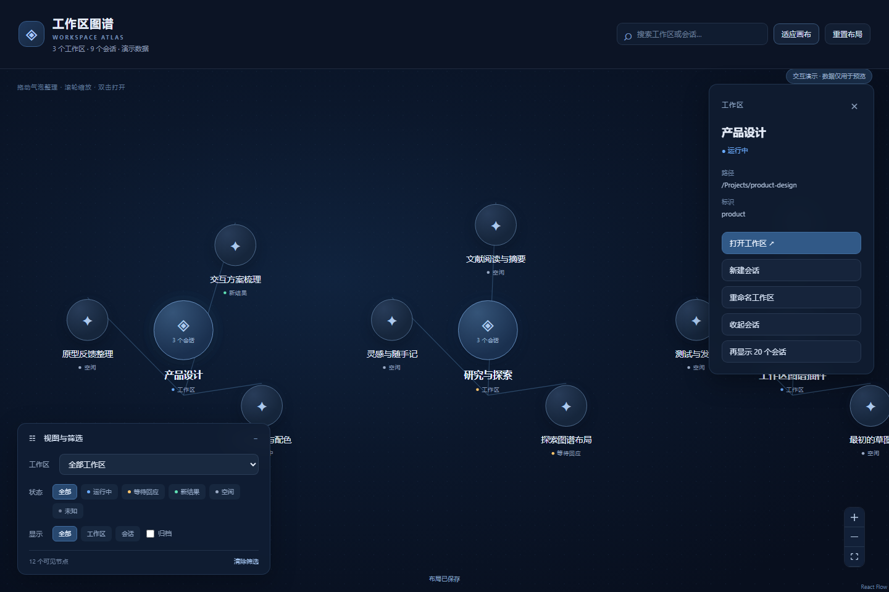

# 工作区图谱 · Workspace Atlas

DeepSeek Harness 原生插件，用可拖动的气泡管理工作区与会话。左下角选择工作区和筛选条件，右侧查看详情并执行原生操作。

## 安装

已验证的目标版本：DeepSeek Harness **0.2.1-rc.2**，Web 界面。Harness 仍处于预览阶段，其他版本可能需要适配。安装到实际使用的 profile；以下示例使用 web：

~~~powershell
npx @deepseek-ai/dsh plugin --profile web add github:qrxf/dsh-workspace-graph
~~~

安装后，在 Harness 侧栏点击 **工作区图谱**。如果当前配置未开启插件热重载，重启对应的 Harness 实例。

仓库包含构建产物，安装不需要自行编译。插件本身没有运行时 npm 依赖，也不需要额外的 API 密钥。

## 使用

- 大气泡为工作区，小气泡为会话，线条表示真实所属关系。
- 首次进入时，当前对话位于画布正中心；没有当前对话时适应全部节点。面板重新进入保留本次运行的视角，后续状态变化不会自动移镜。
- 初次进入仅显示工作区和宿主实际选中的当前会话；单击工作区展开/收起，可同时展开多个工作区。当前会话不受筛选或收起影响，以“当前”和白色外圈标记。
- 状态可以多选，同维度取“或”；时间、频率和状态之间取“且”。工作区保留为导航锚点，无匹配会话时显示说明。
- 普通拖动沿父子连线柔性牵引，远端会有滞后；按住 Ctrl 可单独自由拖动气泡，仍会碰撞并推动接触的气泡。支持拖动中切换 Ctrl。碰撞尺寸在原有基础上增加 25%，画面圆球大小不变。指针停止约 120ms 或松手后，绳子约 1.2 秒逐渐变硬；普通拖动大致恢复原来的相对树形并保留一部分变形和整体位移，Ctrl 的自由重排成为新布局。
- 工作区和会话按真实层级生成向四周分散的树状布局，小气泡从父圆周外侧向外展开；拖动与展开都保留碰撞。连线连接气泡圆周，并随位置实时更新。点击、展开、悬停保持视角不变，顶部“适应画布”给筛选面板留出空间。
- 并行运行、等待回应和宿主当前会话保留可见，越过折叠、分页和筛选限制；“当前”和“工作中”分别标注。当前标记来自本窗口宿主的 mainView 保留集合，不能据此推断其他窗口中的当前焦点。
- 当前气泡显示冰蓝色外光晕；运行中、等待回应和新结果按状态色发光。光晕位于圆球外侧，文字保持清晰；运行和等待仅让光晕缓慢呼吸，开启“减少动态效果”后保留静态发光。
- 展开“主题与动态效果”可选颜色、输入 HEX、恢复默认并减少动态效果，也遵循系统减少动态偏好。深工作区、展开更深、浅会话与运行标识相互独立。
- 会话详情可本地置顶和编辑短概括；已移除悬停/聚焦时的环绕文字与自动移镜。
- 嵌套工作区按宿主目录路径连接到最近的父工作区，并显示“子工作区”标记。分支会话使用宿主 `parentId` 连接来源圆周，优先向树的外侧分布；筛选或分页隐藏来源时，会保留必要的来源链作为上下文。拖动不改变真实归属。
- 拖动气泡调整位置；拖动背景平移，滚轮缩放；顶部可适应画布、重排并撤销。
- 左下角选择工作区，按状态、类型和归档情况筛选；顶部搜索工作区名称、路径或会话标题。
- 搜索也匹配会话目录与手动概括，右侧结果不受折叠和图谱分页限制。点击结果临时显示会话和来源链并定位，可返回定位前视角；搜索结果仍遵循所选时间、状态和归档条件。“清除筛选”切换到全部时间，“恢复默认视图”恢复近期偏好并收起工作区。
- 顶部全局状态按钮显示等待回应、运行中、新结果的互斥计数，可直接列出并定位会话；活动会话越过当前筛选时显示“筛选外活动”。列表视图每批显示 50 条结果，缩小图谱时隐藏次要文字。
- 单击查看详情，双击打开；详情提供新建会话、工作区重命名、会话归档和恢复。
- 默认隐藏空白会话、子代理会话和归档会话，实际当前会话除外。工作区展开后先显示 20 个会话，可在详情中继续展开。
- 运行中会话的归档遵循 Harness 限制；本插件不自动停止正在进行的工作。

拖拽只改变图谱位置，不移动文件、不改变工作目录或会话所属。默认不读取会话正文，不调用模型；可选摘要提供方契约见 [调查与接入边界](docs/summary-provider-research.md)，本次没有真实自动概括插件接入。

默认使用“近期”筛选，也可切换到全部时间；已有明确保存的筛选继续保留。“近期”按宿主持久消息活动时间不超过 7 天计算。“常用”按最近 30 天从本图谱主动打开至少 5 次计算，同会话间隔不足 30 分钟不重复计数。缺少既往访问历史时从本版本开始观察；记录不足显示“使用记录积累中”，不会把悬停、刷新或自动恢复计为打开。原生侧栏的打开来源尚无可靠人工操作事件，因此不计入这个图谱本地指标。

## 布局保存

位置和视角在本次应用运行内保留，切换面板后继续使用；刷新页面、重新启动或重新初始化插件后，所有气泡恢复默认布局，首次视角重新适配。旧版持久坐标与视角不再自动恢复。筛选、主题、动态偏好、置顶、手动概括和本地使用记录继续保存于当前浏览器，使用稳定的原生对象 ID 区分同名对象。重新进入从折叠态开始，活动会话继续显示。

布局不会自动同步至其他浏览器或设备。同一浏览器来源使用独立命名空间；不同 profile 的工作区 ID 保持各自身份，但“全部”视角和筛选可能共用浏览器偏好。

现代浏览器使用 Web Locks 和修订号协调持久设置写入。各窗口布局独立，拖动不写入 localStorage，也不覆盖另一窗口的位置；持久设置更新继续同步。存储被禁用、已满或损坏时显示提示，也可以保存已存原文以便排查。

顶部“备份与恢复”始终可用，可导出完整本地设置和当前布局，或选择最多 5 MB 的 JSON 备份，预览后确认替换。导入先校验格式并检测其他窗口的更新；写入失败保留当前数据。导入的坐标仍只在本次运行保留，概括、置顶、主题、使用记录和筛选持久保存。备份可能包含工作区路径、概括和使用记录，请按需要保管。

顶部“重置布局”只重排位置。存储异常时的“清除全部本地数据”会清除概括、置顶、主题、使用记录、筛选和布局，界面会明确提示并要求确认。

快速远拖后松手，普通拖动继续保留柔性和部分变形；极端拖动的保留变形最多为原连线长度的 20%，避免中心气泡被留在子气泡环的外侧。Ctrl 自由拖动继续保留用户摆放的结果和碰撞。

## 开发与验证

Node.js 22.19+（项目实际验证使用 Node 24）。

~~~sh
npm ci
npm test
npm run typecheck
npm run build
npm run demo
~~~

独立演示使用清楚标注的示例数据，与插件共用同一个界面。浏览器测试自行启动临时演示服务：

~~~sh
npx playwright install chromium
npm run test:browser
~~~

补充回归：`node tests/rope-edge-browser.mjs` 测量圆周端点，`node tests/ctrl-drag-browser.mjs` 验证自由拖动与碰撞，`node tests/runtime-layout-browser.mjs` 验证并行当前会话与重启重置，`npm run test:flex` 验证软绳和停止恢复。`node tests/summary-edge-browser.mjs` 验证边缘聚焦，`node tests/lifecycle-browser.mjs` 验证键盘及资源释放，`npm run test:performance` 测量 10/50/100 个真实节点帧间隔，`node tests/physics-benchmark.ts` 单独测量物理计算。PowerShell 设置 `$env:BROWSER_CHANNEL='msedge'` 可使用系统 Edge，缺录屏依赖时设置 `$env:WG_SKIP_VIDEO='1'`。最新验证见 [布局与交互记录](docs/verification-2026-10-25-layout-interaction.md)。

真实宿主集成测试使用临时 DSH_HOME、合成工作区及独立端口，不使用真实用户的会话或密钥。先设置 DSH_CLI 为已安装 dsh 的 lib/bin.js，再执行：

~~~sh
npm run test:native
~~~

`npm run test:interactions` 顺序运行导航、千级目录、首次居中、密集环松手、圆周连线、Ctrl/柔性拖动、运行布局、隐藏层级与生命周期回归；`npm run test:catalog` 测量 1,000／5,000 条会话的投影。CI 自动执行两者，版本标签或手动触发运行固定 DSH 0.2.1-rc.2 的隔离原生验证。慢速冷启动可设置 `DSH_BOOT_TIMEOUT_MS=180000`。本轮记录见 [导航与恢复验证](docs/verification-2026-10-27.md)。

测试覆盖：所属关系、状态优先级、过滤后的坐标保留、归档显示、分批展开、损坏存储、保存冲突、拖拽后刷新、筛选、搜索和恢复会话。完整验证记录见 [docs/verification.md](docs/verification.md)。

## 结构

~~~text
src/client.tsx       Harness 原生页面与侧栏入口
src/adapter.ts       原生工作区/会话快照转换
src/model.ts         图谱投影、所属关系与筛选
src/layout.ts        浏览器布局存储、校验与冲突处理
src/GraphPage.tsx    画布、筛选面板与详情
src/styles.css      深蓝气泡界面
src/host.ts          无 Host 侧行为的入口
scripts/build.mjs   ModuleLoader 客户端打包
~~~

React、ReactDOM 使用宿主提供的实例；React Flow 随客户端打包。没有增加模型工具、自动任务或文件系统操作。禁用插件时注册项与样式随生命周期移除。

## License

MIT。随客户端打包的第三方许可见 dist/THIRD_PARTY_LICENSES.txt。

A native draggable workspace/session graph for DeepSeek Harness. Browser-local layout persistence, bottom-left filters, search, and native navigation. Tested target: DSH 0.2.1-rc.2. No extra model calls or API key required.
